# Praguedex

A location-based collecting game for Prague: walk to a real place, stand there, and its card is yours. Built on the MERN stack, installable as a PWA.

Nearly 1,500 location cards (1,275 in Prague, 210 more across Bohemia), each with a hand-written story in English, Czech and Chinese (Simplified and Traditional), plus a History Timeline that tells Prague's story in 24 eras. Go there. Stand there. The app notices.

**Live:** [praguedex.com](https://praguedex.com) · open as a guest, no account needed to look around. The in-app [Guide](https://praguedex.com/guide) explains everything with interactive demos.

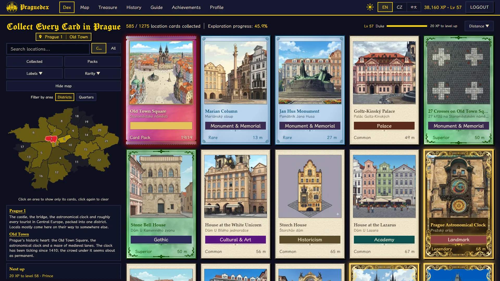

| A card's story | The map |
|---|---|
| 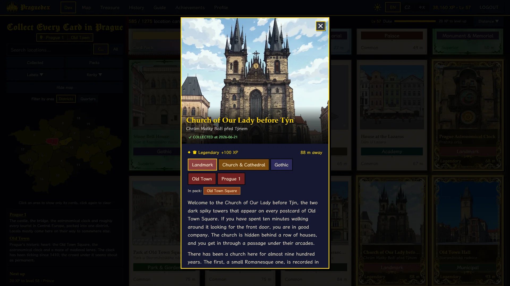 | 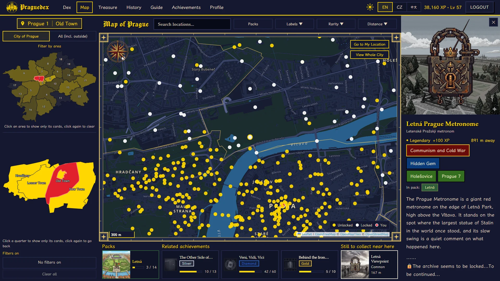 |

| Profile | Achievements |
|---|---|
| 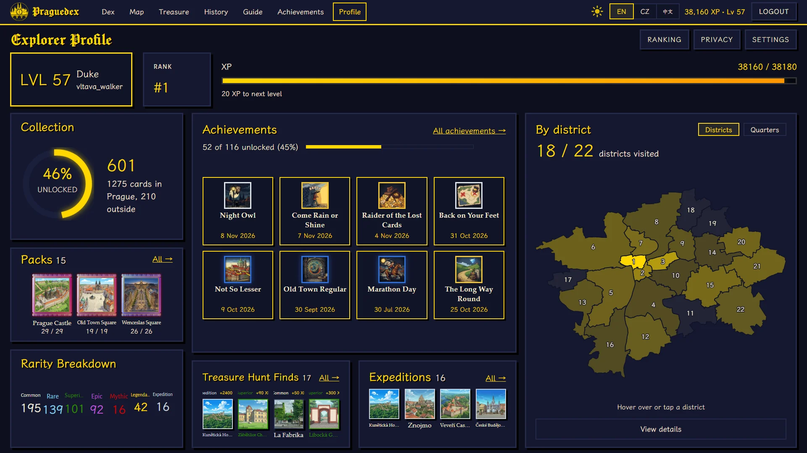 | 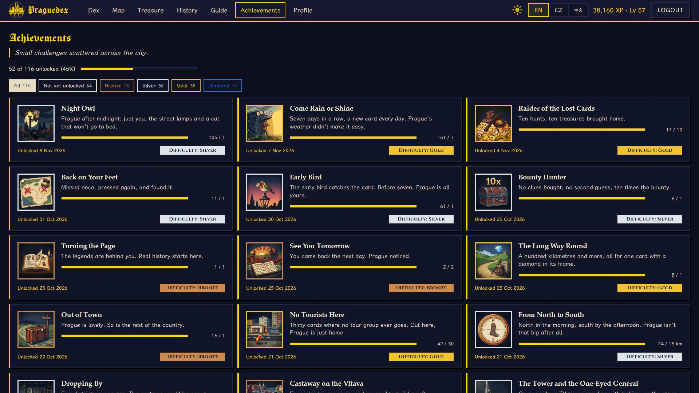 |

**History Timeline:** one event per page with a timeline of eras and events across the top, illustrations, primary-source quote boxes, background cards, related achievements, and the real places where it happened.

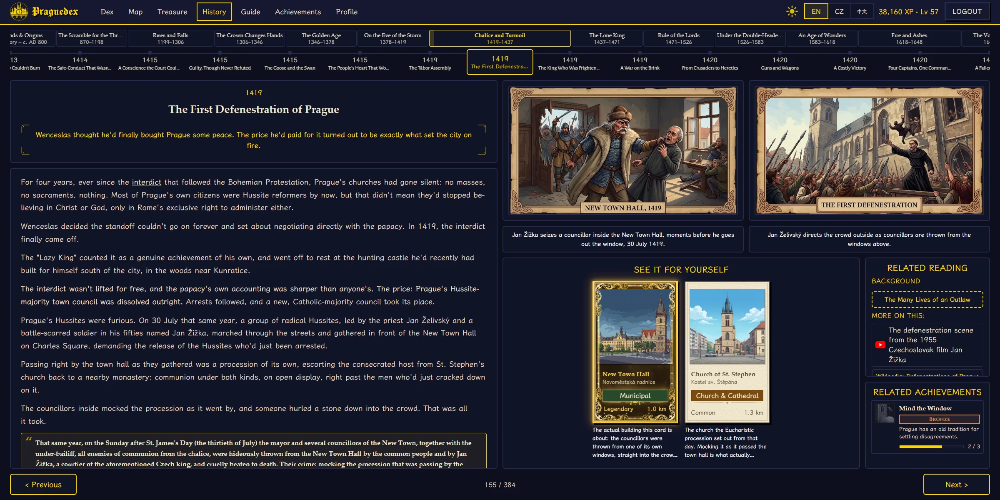

**On your phone:** a first visit asks before using your location (both answers look the same), then the Dex with your district and level, card packs, and a long press on a collected card to show it off full screen.

<table>
  <tr>
    <td align="center">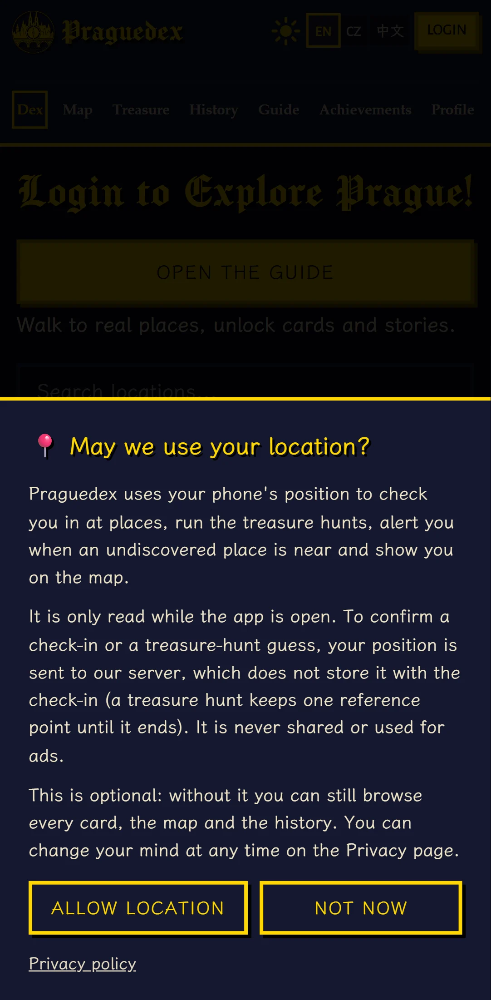</td>
    <td align="center">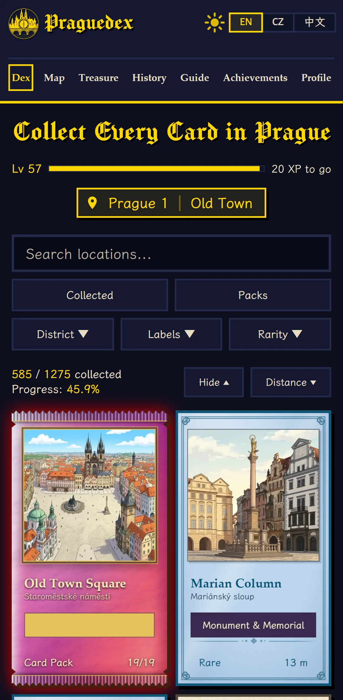</td>
    <td align="center">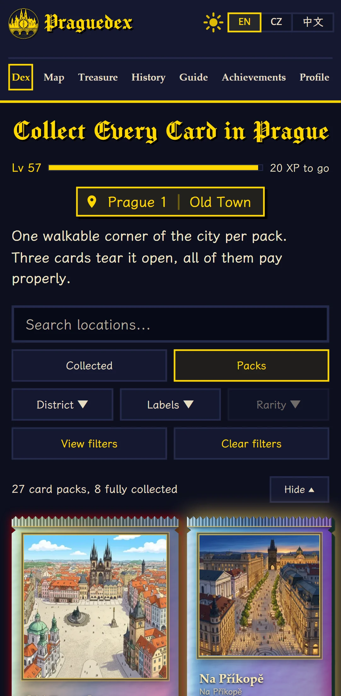</td>
    <td align="center">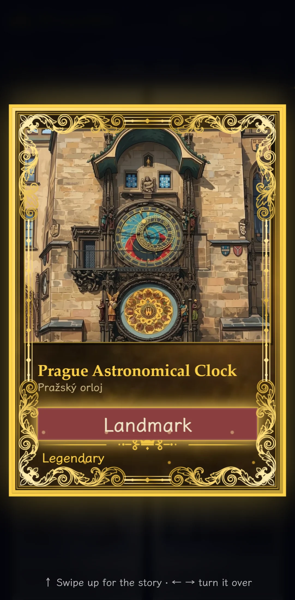</td>
  </tr>
</table>

| Treasure Hunt | Guide |
|---|---|
| 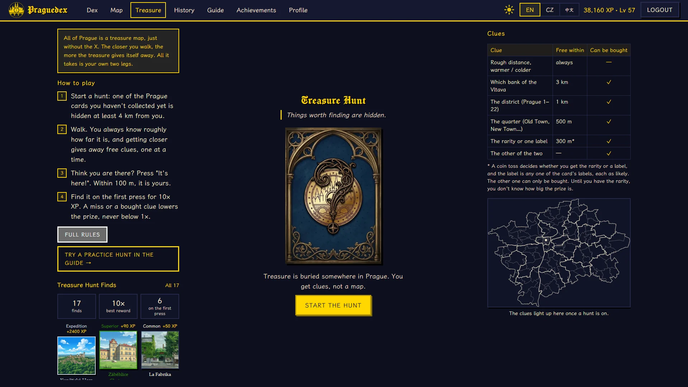 | 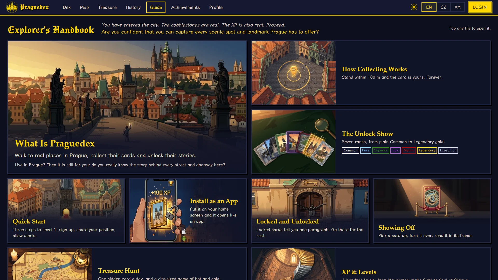 |

---

## Stack

| Layer    | Tech |
| -------- | ---- |
| Frontend | React 18, Vite, React Router 6, Leaflet with a MapLibre vector base map (OpenFreeMap tiles), opencc-js |
| Backend  | Node.js, Express (ES modules) |
| Database | MongoDB Atlas (Frankfurt), Mongoose |
| Auth     | JWT (jsonwebtoken, bcryptjs) |
| Images   | Local WebP covers with generated thumbnails; Cloudinary as upload backend and fallback |
| AI       | Google Gemini (fallback descriptions for cards without one) |
| Testing  | Jest, React Testing Library, supertest, mongodb-memory-server, Playwright |
| Hosting  | Vercel (client, praguedex.com), Render (API), GitHub Actions CI |

---

## Features

### Collect the city

- **Nearly 1,500 location cards** in Prague and across Bohemia: castles, Baroque churches, metro stations, Cold War bunkers, a psychiatric hospital that hosts music festivals, the southernmost point of Prague.
- **GPS-verified check-ins:** the server checks you are within 100 m of the place. Check-ins are permanent.
- **Stories are a reward:** until you collect a card, the server sends only the opening of its story; the full text unlocks with the check-in.
- **Proximity alerts:** walk within 50 m of an undiscovered place and the app tells you, with an optional system notification that checks you in when tapped.
- **The Dex:** filter by grouped labels (era, architectural style, building type, …), rarity, district or historical quarter, straight from a clickable map of Prague; sort by distance, newest, rarity or recently collected. A hover preview shows a card's first paragraph; the side column shows your district and quarter, and what is next: XP to the next level, the nearest card, the day's hunt, your place in the History Timeline and the achievements closest to done.
- **Where you are:** your district and quarter are worked out on your device from the official boundaries (ČÚZK RÚIAN), so your position never leaves it.
- **Card showcase:** long-press (or double-click) a collected card to hold it up full screen; drag sideways to flip it over, swipe up to read its story.

### Card packs and area guides

- **27 card packs**, each one walkable corner of the city (Prague Castle, Old Town Square, Vyšehrad, Letná, …). Three cards open a pack, all of them complete it, and both pay XP.
- **Area guides** for all 22 districts and 112 historical quarters: what life is like there today and the stereotypes for districts, the history for quarters, with the places worth collecting.

### Rarity and progression

Seven rarities. Each is printed on its own material in its own frame, and the rarer it is, the more it moves:

| Rarity     | Material         | XP      |
| ---------- | ---------------- | ------- |
| Common     | Paper            | 10      |
| Rare       | Porcelain        | 20      |
| Superior   | Jade             | 30      |
| Epic       | Amethyst         | 50      |
| Mythic     | Bohemian garnet  | 70      |
| Legendary  | Gold             | 100     |
| Expedition | Silver, platinum | 60–300 by distance from Charles Bridge; the stone in the frame shows the step |

Locked cards show only their frame, in grey. Every looping effect animates only `transform` or `opacity`, so a screen of legendary cards stays smooth on a phone.

- **100 explorer levels**, one path through Prague's history from Newcomer at the Gate to Soul of Prague, with a level-up celebration.
- **116 achievements** with pixel-art icons, a one-line flavour text, the exact requirement and live progress, paying XP in four tiers (Bronze 25, Silver 150, Gold 400, Diamond 800). Some are sets of places (the three defenestration windows, the seven central bridges), some reward a day out (before 7 a.m., seven days in a row), some the treasure hunt or the History Timeline. A check-in shows which achievements and packs it moved forward.
- **Leaderboard** and public **explorer pages** for signed-in players.

### Treasure Hunt

One hunt a day: one of your uncollected Prague cards is hidden at least 4 km away. The target's location never reaches the client; the server works out every clue from the position you report.

- You always know roughly how far it is and whether you are getting warmer. Walking closer gives free clues one at a time: which bank of the Vltava, the district, the quarter, then the rarity or a label.
- Press "It's here!" within 100 m to find it. A find on the first press pays 10× the card's XP; a miss or a bought clue lowers the prize, never below 1×.
- The Guide has a practice hunt driven by the same rules.

### History Timeline

- **455 hand-written cards in 24 eras**, from the founding legends onwards, in three languages, with illustrations, primary-source quote boxes, background cards and inline links between events. It is still being written.
- A **book view** with a draggable timeline of eras and events; each event shows the real places where it happened (their cards open in place) and the achievements that belong to it.
- Remembers where you stopped reading, across devices for signed-in players.

### Languages and themes

- Full UI and content in **English, Czech and Chinese**, with a Simplified / Traditional switch (opencc-js, with Taiwan terms).
- Light and dark themes. Language and theme follow a signed-in player to every device.

### Privacy

- **No location is read before the user agrees.** A consent dialog explains what is collected and why; both answers look the same, and the app works without location.
- Consent can be withdrawn at any time on the **Privacy** page (`/privacy`), which carries the GDPR notice. Signed-in players' decisions are stored as a versioned record and synced across devices.
- The server keeps no check-in positions and deletes the only stored hunt position when the hunt ends.

### Guest mode and PWA

- A first visit lands in guest mode on the Dex, with a welcome board of the Guide's tiles: everything can be browsed, and collecting needs an account.
- Installable on iOS and Android with its own launch screen, and an install prompt after signing up on a phone. A new deploy is picked up the next time the app comes to the foreground.
- Pages turn like a book and keep their data for the visit, so switching pages shows no spinner.

---

## Getting started

Prerequisites: Node.js 20, a MongoDB instance (local or Atlas), optionally a Gemini API key and a Cloudinary account.

```bash
# 1. Install
cd server && npm install
cd ../client && npm install

# 2. Configure the server (see Environment variables below)
cp server/.env.example server/.env

# 3. Seed the location cards and the History Timeline
cd server
node src/data/seedLocations.js
node src/data/seedHistoryEvents.js

# 4. Start the API (port 5000)
npm run dev

# 5. Start the client (port 5173), in a second terminal
cd client && npm run dev
```

Open http://localhost:5173. With `NODE_ENV=development` the server skips the GPS distance check, so check-ins work without being in Prague.

### Environment variables (`server/.env`)

```env
MONGO_URI=mongodb://localhost:27017/prague-stories
JWT_SECRET=your_jwt_secret_here
JWT_EXPIRES_IN=7d
GEMINI_API_KEY=your_gemini_api_key_here
CLOUDINARY_CLOUD_NAME=your_cloud_name
CLOUDINARY_API_KEY=your_cloudinary_api_key
CLOUDINARY_API_SECRET=your_cloudinary_api_secret
CLIENT_ORIGIN=https://your-frontend-domain.example
PORT=5000
NODE_ENV=development
```

---

## Project structure

```
praguedex/
├── client/                      React + Vite PWA
│   ├── public/
│   │   ├── pixel-art/           cover images (+ thumbs/, generated)
│   │   ├── history/             History Timeline illustrations
│   │   ├── achievements/        achievement icons
│   │   └── brand/               logo, card backs, textures, launch screens
│   ├── scripts/                 cover manifest and thumbnails, Prague boundaries, card textures, splash
│   ├── e2e/                     Playwright specs (backend mocked via page.route)
│   └── src/
│       ├── pages/               Explore (the Dex), Map, TreasureHunt, History, Dashboard, Achievements,
│       │                        Leaderboard, Explorer, Guide, Privacy, Login, Register
│       ├── components/          locations/, packs/, map/, history/, draw/, dashboard/, guide/, shared/
│       ├── context/             Auth, Language (i18n + opencc), Theme
│       ├── hooks/               proximity detection, user position, entrances, fitting, …
│       ├── services/api.js      axios API layer
│       └── utils/               area guides, Prague areas, rarity, covers, guide content, …
└── server/                      Express API
    └── src/
        ├── app.js / index.js    app (no listen, used by tests) / entry point
        ├── models/              User, Location, CheckIn, HistoryEvent
        ├── controllers/         auth, location, checkin, user, pack, history
        ├── services/            gamification, achievement stats, card catalog, check-in gains, Gemini
        └── data/                seed scripts, rarity map, packs, eras, maintenance scripts
```

---

## API

| Method | Route | Auth | Description |
| ------ | ----- | ---- | ----------- |
| POST | `/api/auth/register` | — | Create an account |
| POST | `/api/auth/login` | — | Returns a JWT |
| GET | `/api/auth/me` | ✓ | Current player |
| GET | `/api/locations` | optional | All cards (no stories), with unlock status when signed in |
| GET | `/api/locations/:slug` | optional | One card; the full story only for those who collected it |
| POST | `/api/locations` | ✓ | Add a card |
| PUT · DELETE | `/api/locations/:slug` | admin | Edit or remove a card |
| POST | `/api/locations/:slug/cover` | admin | Upload a cover (WebP via sharp, Cloudinary) |
| GET | `/api/checkins` | ✓ | Check-in history |
| POST | `/api/checkins/:slug` | ✓ | Check in: GPS check, XP, achievements, packs |
| GET | `/api/packs` · `/api/packs/:slug` | optional | Card packs and one pack with its cards |
| GET | `/api/user/progress` | optional | XP, level, collection breakdown |
| GET | `/api/user/achievements` | optional | Achievements with progress, levels |
| GET · POST | `/api/user/random-draw` | ✓ | Treasure hunt: status / start |
| POST | `/api/user/random-draw/guess` · `/clue` | ✓ | Press "It's here!", buy a clue |
| GET | `/api/user/treasures` · `/expeditions` | ✓ | Treasure finds, expedition cards |
| GET · PUT | `/api/user/history-progress` | ✓ | History Timeline reading position |
| POST | `/api/user/area-guide-read` | ✓ | Mark an area guide as read |
| PUT | `/api/user/preferences` | ✓ | Theme, language, Chinese script |
| PUT | `/api/user/location-consent` | ✓ | Record location consent or its withdrawal |
| GET | `/api/user/leaderboard` | ✓ | XP leaderboard |
| GET | `/api/user/explorers/:username` | ✓ | Public explorer page |
| GET | `/api/history` | optional | Eras and events (`?lang=en\|cz\|zh` trims the payload) |

---

## Scripts

| Where | Command | Purpose |
| ----- | ------- | ------- |
| server | `node src/data/seedLocations.js` | Upsert the seeded location cards |
| server | `node src/data/seedHistoryEvents.js` | Upsert History Timeline events |
| server | `npm run export:locations` | Export the database to the seed files |
| server | `npm run sync:covers` | Download Cloudinary covers to local files |
| server | `npm run sync:expedition` | Recompute rarity/XP of cards outside Prague (`--dry` to preview) |
| server | `npm run purge:hunt-positions` | Delete stored hunt positions that are no longer needed (`--dry` to preview) |
| client | `npm run generate:covers` | Rebuild the cover manifest and thumbnails (also runs on dev/build) |

---

## Testing

```bash
cd server && npm test           # 245 tests: unit + API integration (in-memory MongoDB)
cd client && npm test           # 195 tests: units and React components
cd client && npm run test:e2e   # 226 Playwright tests, backend mocked
```

- **Server:** pure-function tests for rarity, gamification and hunt rules, and integration tests that drive the real Express app with supertest against `mongodb-memory-server` (real indexes, populate and write behaviour). Cloudinary and Gemini are mocked.
- **Client:** Jest and React Testing Library for utilities (geolocation, consent, Prague areas, covers, guide texts kept in step with the server's rules) and components.
- **End to end:** Playwright with the backend mocked via `page.route`, including touch gestures (card showcase), treasure hunts, check-ins, page turns and the consent flow (asserting no geolocation call before consent).
- The server and client Jest suites run in GitHub Actions on every push to `main`.

---

## License

MIT
